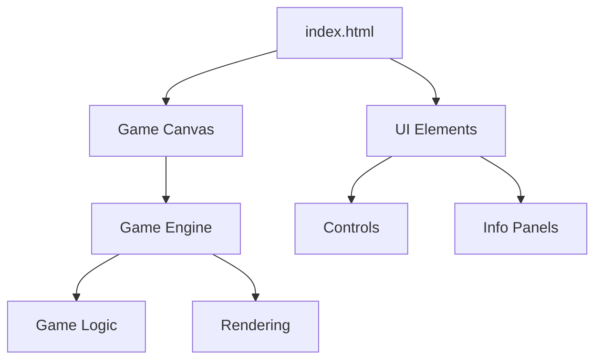

## 1. Architecture Design
纯前端单页面应用，使用 HTML5 Canvas 进行游戏渲染，JavaScript 处理游戏逻辑，CSS 负责样式和动画。

## 2. Technology Description
- 前端：纯 HTML + CSS + JavaScript
- 渲染：HTML5 Canvas API
- 样式：原生 CSS
- 动画：CSS animations 和 requestAnimationFrame
- 无后端、无数据库
- 无外部依赖

## 3. Route Definitions
单页面应用，无路由

## 4. API Definitions
无后端 API

## 5. Server Architecture Diagram
无后端

## 6. Data Model
无数据库
