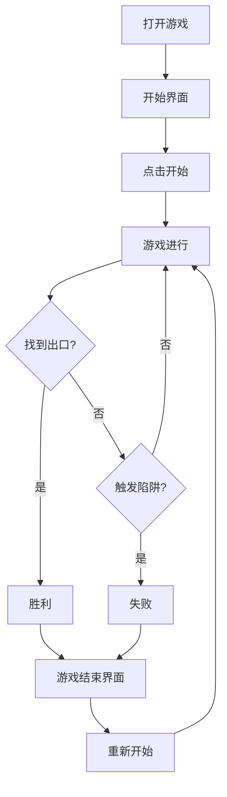

## 1. Product Overview
一款网页版的逃离古堡小游戏，类似蛋仔派对中的玩法，玩家操控可爱的角色在古堡迷宫中探索，收集钥匙、避开陷阱、找到出口逃离。
- 主要目的是提供一款有趣的休闲小游戏，适合各年龄层用户
- 市场价值是填补蛋仔派对网页版小游戏的空缺

## 2. Core Features

### 2.1 User Roles
| Role | Registration Method | Core Permissions |
|------|---------------------|------------------|
| 玩家 | 无需注册 | 直接开始游戏，查看分数和记录 |

### 2.2 Feature Module
1. **游戏主页面**: 游戏画布、控制按钮、信息面板
2. **开始界面**: 游戏标题、开始按钮、游戏说明
3. **游戏结束界面**: 得分展示、重新开始按钮

### 2.3 Page Details
| Page Name | Module Name | Feature description |
|-----------|-------------|---------------------|
| 游戏主页面 | 游戏画布 | 使用Canvas绘制游戏场景，玩家、墙壁、陷阱、钥匙、门、出口 |
| 游戏主页面 | 控制按钮 | 方向键控制、移动端触摸按钮 |
| 游戏主页面 | 信息面板 | 显示得分、时间、收集的钥匙数量 |
| 开始界面 | 开始按钮 | 点击开始游戏 |
| 开始界面 | 游戏说明 | 显示游戏规则和操作说明 |
| 游戏结束界面 | 得分展示 | 显示最终得分和用时 |
| 游戏结束界面 | 重新开始 | 重新开始游戏 |

## 3. Core Process
用户打开游戏 → 点击开始 → 操控角色移动 → 收集钥匙 → 避开陷阱 → 找到出口 → 游戏胜利或失败 → 重新开始

## 4. User Interface Design
### 4.1 Design Style
- 主色调：深紫色、深蓝色（古堡主题），配合金色（钥匙）和红色（陷阱）
- 按钮风格：圆润、带有阴影效果的复古按钮
- 字体：使用奇幻风格的字体，搭配卡通体
- 布局风格：居中布局，游戏画布为主，两侧或下方为信息面板
- 图标风格：可爱的卡通风格图标

### 4.2 Page Design Overview
| Page Name | Module Name | UI Elements |
|-----------|-------------|-------------|
| 游戏主页面 | 游戏画布 | 深色背景、卡通角色、迷宫墙壁、金色钥匙、红色陷阱、绿色出口 |
| 游戏主页面 | 控制按钮 | 透明背景、带边框的方向按钮，悬停和点击有反馈 |
| 游戏主页面 | 信息面板 | 半透明深色背景，金色文字 |
| 开始界面 | 标题 | 大字体，带有发光效果 |
| 开始界面 | 开始按钮 | 金色渐变按钮，悬停放大 |

### 4.3 Responsiveness
- 桌面端：键盘控制 + 触摸按钮
- 移动端：全屏适配，触摸控制，响应式布局

### 4.4 No 3D Scene Guidance
这是一个2D游戏，不需要3D场景
