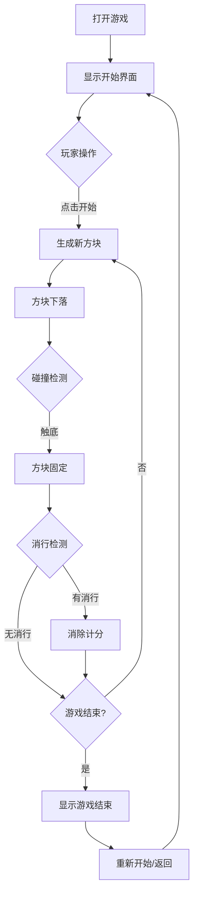
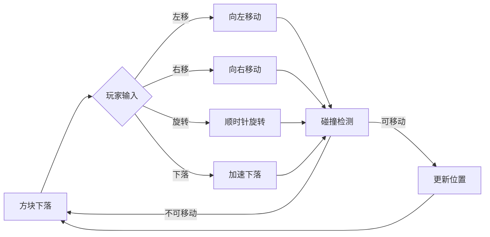

# 微信俄罗斯方块小游戏 PRD

## 1. 产品概述

一款适配微信小程序的经典俄罗斯方块游戏，融合现代霓虹赛博朋克视觉风格，为玩家带来沉浸式街机体验。简洁直观的上手体验配合炫酷视觉效果，让玩家重温经典游戏乐趣的同时感受潮流美学。

**核心目标用户**：休闲游戏爱好者、怀旧玩家、寻求碎片化娱乐的用户

**核心价值**：无需下载、随时可玩、视觉出众、操作流畅

---

## 2. 核心功能

### 2.1 用户角色

| 角色 | 说明 | 权限 |
|------|------|------|
| 游客玩家 | 无需登录，直接开始游戏 | 完整游戏体验 |

### 2.2 功能模块

**游戏核心模块**
1. **游戏主界面**：游戏画布、计分板、控制按钮、开始/暂停按钮
2. **方块预览**：显示即将落下的下一个方块
3. **计分系统**：实时显示当前分数和消除行数
4. **等级系统**：随分数提升游戏速度加快
5. **游戏结束**：显示最终得分和重新开始选项

**控制模块**
1. **键盘控制**：方向键/ WASD 控制方块移动和旋转
2. **触屏控制**：左右滑动移动方块，上滑旋转，下滑加速下落
3. **暂停/继续**：空格键或点击按钮控制游戏暂停

---

## 3. 核心流程

### 3.1 游戏主流程

### 3.2 方块操作流程

---

## 4. 用户界面设计

### 4.1 设计风格

**主题风格**：赛博朋克霓虹街机风

**配色方案**
- 主色调：深蓝黑 `#0a0e27` 作为背景
- 霓虹蓝：`#00f5ff` 用于主要UI元素
- 霓虹粉：`#ff00ff` 用于强调和高亮
- 霓虹紫：`#bf00ff` 用于方块渐变
- 霓虹绿：`#39ff14` 用于成功提示
- 霓虹黄：`#ffff00` 用于计分显示
- 白色：`#ffffff` 用于文字

**方块颜色**
- I型方块：青色 `#00f5ff`
- O型方块：黄色 `#ffff00`
- T型方块：紫色 `#bf00ff`
- S型方块：绿色 `#39ff14`
- Z型方块：红色 `#ff3366`
- J型方块：蓝色 `#3366ff`
- L型方块：橙色 `#ff9933`

**字体设计**
- 标题字体：`Orbitron` (Google Fonts) - 科技感
- 数字字体：`Press Start 2P` (Google Fonts) - 复古像素风
- 回退字体：`monospace`

**布局风格**
- 居中单列布局，最大宽度 400px
- 游戏区域居中显示
- 控制区域在游戏区域下方
- 霓虹发光边框效果
- 网格背景装饰

**动效设计**
- 方块消除时闪烁效果
- 分数增加时放大跳动
- 游戏结束时震动效果
- 霓虹边框呼吸灯效果
- 背景扫描线动画

### 4.2 页面设计概览

| 页面 | 模块 | 视觉元素 |
|------|------|----------|
| 游戏页 | 游戏画布 | 10x20 格子，深色背景带网格线，霓虹边框发光 |
| 游戏页 | 下一个方块预览 | 4x4 预览区，霓虹边框，显示下一个方块 |
| 游戏页 | 计分面板 | 分数/行数/等级显示，霓虹数字风格 |
| 游戏页 | 控制按钮 | 触摸友好的大按钮，霓虹发光效果 |
| 游戏页 | 开始/暂停 | 居中按钮，渐变霓虹背景 |

### 4.3 响应式设计

- **桌面端**：键盘操作为主，触摸区域隐藏
- **移动端**：触屏操作为主，底部显示触摸控制按钮
- **自适应**：游戏区域根据屏幕宽度等比缩放，最大 400px
- **触摸优化**：触摸按钮足够大（至少 48px），防止误触

### 4.4 音效设计（可选）

- 方块移动：轻微点击音效
- 方块旋转：旋转音效
- 方块落底：落地音效
- 消行：消除音效
- 游戏结束：结束音效

---

## 5. 游戏规则

### 5.1 方块类型

经典7种俄罗斯方块（Tetromino）：
- I型：长条形，4格
- O型：正方形，2x2
- T型：T字形
- S型：S字形
- Z型：Z字形
- J型：J字形
- L型：L字形

### 5.2 计分规则

| 操作 | 分数 |
|------|------|
| 消除1行 | 100 |
| 消除2行 | 300 |
| 消除3行 | 500 |
| 消除4行 | 800 |

### 5.3 等级规则

- 每消除10行升一级
- 初始下落间隔：800ms
- 每升一级下落间隔减少 50ms
- 最低下落间隔：100ms

### 5.4 游戏结束条件

当新生成的方块无法放置在初始位置时，游戏结束。

---

## 6. 技术实现要点

### 6.1 方块表示

使用 4x4 矩阵表示每个方块形状，矩阵中 1 表示有方块，0 表示空白。

### 6.2 碰撞检测

- 检测方块移动/旋转后是否超出边界
- 检测方块移动/旋转后是否与已固定的方块重叠

### 6.3 消行检测

每当前一个方块固定后，检查所有已满的行，消除这些行并上移上方的行。

### 6.4 性能优化

- 使用 requestAnimationFrame 控制游戏循环
- 避免在游戏循环中创建新对象
- 使用 Canvas 而非 DOM 元素渲染游戏画面
