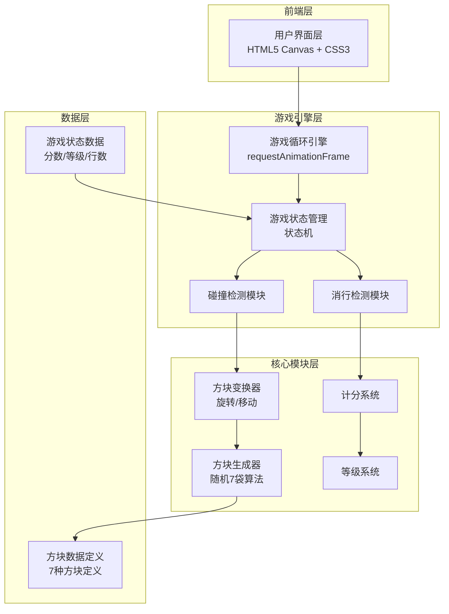
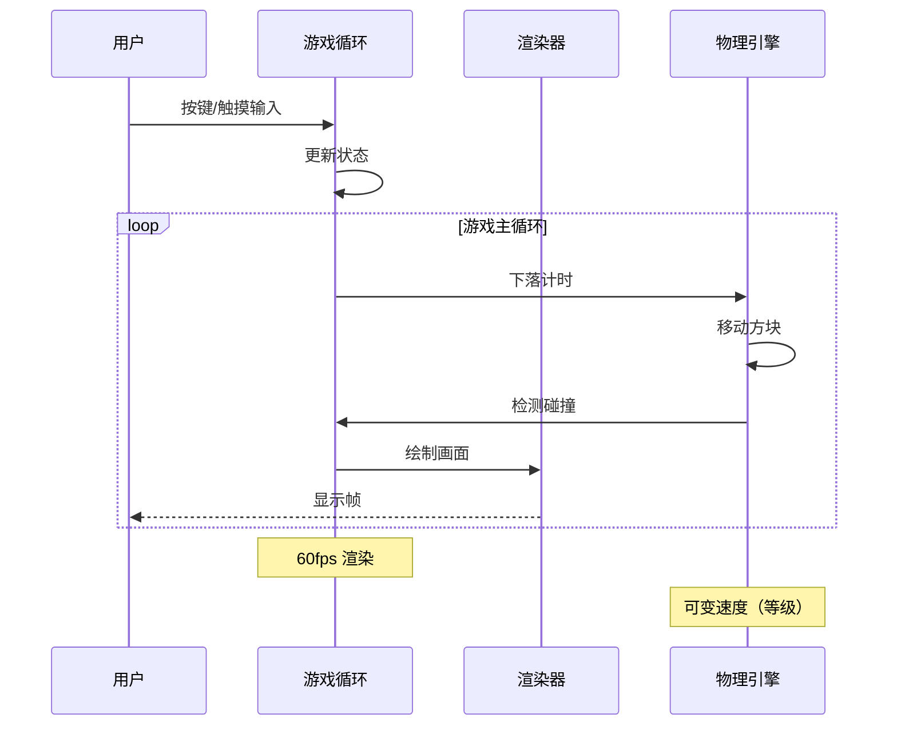

# 微信俄罗斯方块小游戏 技术架构文档

## 1. 架构设计



## 2. 技术选型

### 2.1 前端技术栈

| 技术 | 版本 | 用途 |
|------|------|------|
| HTML5 | - | 游戏页面结构 |
| CSS3 | - | 样式、动画、响应式布局 |
| JavaScript | ES6+ | 游戏逻辑 |
| Canvas API | 2D | 游戏渲染 |

### 2.2 外部资源

| 资源 | 来源 | 用途 |
|------|------|------|
| Google Fonts | CDN | Orbitron、Press Start 2P 字体 |
| 无依赖库 | - | 纯原生实现，最小化体积 |

### 2.3 项目结构

```
/workspace/
├── index.html          # 游戏主页面
├── styles.css          # 样式文件
├── game.js             # 游戏逻辑文件
└── README.md           # 项目说明
```

## 3. 游戏画布规格

| 参数 | 值 | 说明 |
|------|------|------|
| 游戏区域宽度 | 10 格 | 标准俄罗斯方块宽度 |
| 游戏区域高度 | 20 格 | 标准俄罗斯方块高度 |
| 方块大小 | 25px | 每个格子像素尺寸 |
| 画布宽度 | 250px | 10 x 25 |
| 画布高度 | 500px | 20 x 25 |
| 预览区大小 | 4 x 4 格 | 显示下一个方块 |

## 4. 数据模型

### 4.1 方块定义

```javascript
const TETROMINOES = {
  I: {
    shape: [
      [0, 0, 0, 0],
      [1, 1, 1, 1],
      [0, 0, 0, 0],
      [0, 0, 0, 0]
    ],
    color: '#00f5ff'
  },
  O: {
    shape: [
      [1, 1],
      [1, 1]
    ],
    color: '#ffff00'
  },
  T: {
    shape: [
      [0, 1, 0],
      [1, 1, 1],
      [0, 0, 0]
    ],
    color: '#bf00ff'
  },
  S: {
    shape: [
      [0, 1, 1],
      [1, 1, 0],
      [0, 0, 0]
    ],
    color: '#39ff14'
  },
  Z: {
    shape: [
      [1, 1, 0],
      [0, 1, 1],
      [0, 0, 0]
    ],
    color: '#ff3366'
  },
  J: {
    shape: [
      [1, 0, 0],
      [1, 1, 1],
      [0, 0, 0]
    ],
    color: '#3366ff'
  },
  L: {
    shape: [
      [0, 0, 1],
      [1, 1, 1],
      [0, 0, 0]
    ],
    color: '#ff9933'
  }
};
```

### 4.2 游戏状态

```javascript
const gameState = {
  board: [],           // 10x20 二维数组，记录已固定的方块
  currentPiece: {},   // 当前下落的方块
  nextPiece: {},       // 下一个方块
  position: {x, y},    // 当前方块位置
  score: 0,            // 当前分数
  lines: 0,            // 已消除行数
  level: 1,           // 当前等级
  isPlaying: false,   // 游戏是否进行中
  isPaused: false     // 是否暂停
};
```

### 4.3 等级与速度

```javascript
const LEVEL_CONFIG = {
  baseInterval: 800,    // 初始下落间隔（毫秒）
  minInterval: 100,     // 最小下落间隔
  decreasePerLevel: 50, // 每级减少的间隔
  linesPerLevel: 10     // 每级需要的消行数
};
```

## 5. 核心算法

### 5.1 方块随机生成（7袋算法）

确保每生成7个方块后，所有7种方块都出现一次。

```javascript
class PieceGenerator {
  bag = [];
  
  getNextPiece() {
    if (this.bag.length === 0) {
      this.bag = ['I', 'O', 'T', 'S', 'Z', 'J', 'L'];
      this.shuffle(this.bag);
    }
    return this.bag.pop();
  }
}
```

### 5.2 碰撞检测算法

```javascript
function canMove(piece, offsetX, offsetY, rotation = null) {
  const shape = rotation || piece.shape;
  
  for (let y = 0; y < shape.length; y++) {
    for (let x = 0; x < shape[y].length; x++) {
      if (shape[y][x]) {
        const newX = piece.x + x + offsetX;
        const newY = piece.y + y + offsetY;
        
        // 检测边界
        if (newX < 0 || newX >= 10 || newY >= 20) {
          return false;
        }
        
        // 检测与其他方块碰撞
        if (newY >= 0 && board[newY][newX]) {
          return false;
        }
      }
    }
  }
  return true;
}
```

### 5.3 消行检测算法

```javascript
function clearLines() {
  let linesCleared = 0;
  
  for (let y = 19; y >= 0; y--) {
    if (board[y].every(cell => cell !== 0)) {
      board.splice(y, 1);
      board.unshift(Array(10).fill(0));
      linesCleared++;
      y++; // 重新检查当前行
    }
  }
  
  return linesCleared;
}
```

### 5.4 旋转算法（SRS旋转系统简化版）

支持基本旋转，优先尝试原位置，如果碰撞则尝试左右偏移。

```javascript
function rotate(piece) {
  const rotated = rotateMatrix(piece.shape);
  
  // 尝试原始位置
  if (canMove(piece, 0, 0, rotated)) {
    return rotated;
  }
  
  // 尝试左右偏移1格
  if (canMove(piece, 1, 0, rotated)) {
    return { shape: rotated, offsetX: 1 };
  }
  if (canMove(piece, -1, 0, rotated)) {
    return { shape: rotated, offsetX: -1 };
  }
  
  return null; // 无法旋转
}
```

## 6. 游戏循环



## 7. 事件处理

### 7.1 键盘控制

| 按键 | 动作 |
|------|------|
| ← / A | 左移 |
| → / D | 右移 |
| ↑ / W | 旋转 |
| ↓ / S | 加速下落 |
| 空格 | 暂停/继续 |

### 7.2 触屏控制

| 手势 | 动作 |
|------|------|
| 左滑 | 左移 |
| 右滑 | 右移 |
| 上滑 | 旋转 |
| 下滑 | 加速下落 |
| 点击暂停按钮 | 暂停/继续 |

## 8. 性能优化策略

1. **Canvas 渲染优化**
   - 只在状态变化时重绘
   - 使用脏矩形技术优化局部更新
   - 预渲染静态元素到离屏 Canvas

2. **游戏循环优化**
   - 使用 `requestAnimationFrame` 保证流畅度
   - 分离更新逻辑和渲染逻辑
   - 避免在循环中创建新对象

3. **事件处理优化**
   - 使用节流控制连续按键
   - 触摸事件使用 `passive: true`

## 9. 本地存储

使用 `localStorage` 保存最高分记录：

```javascript
const STORAGE_KEY = 'tetris_highscore';

// 保存最高分
function saveHighScore(score) {
  const current = localStorage.getItem(STORAGE_KEY);
  if (!current || score > parseInt(current)) {
    localStorage.setItem(STORAGE_KEY, score);
    return true;
  }
  return false;
}

// 获取最高分
function getHighScore() {
  return localStorage.getItem(STORAGE_KEY) || 0;
}
```
